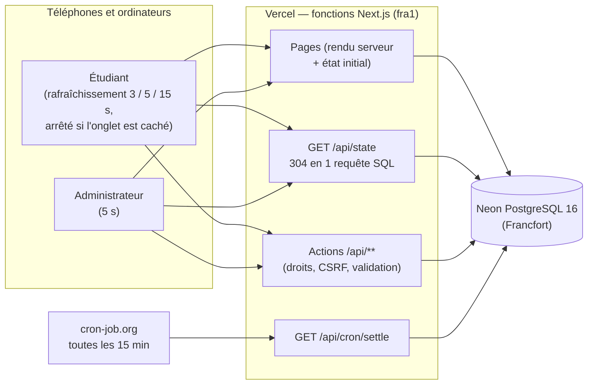
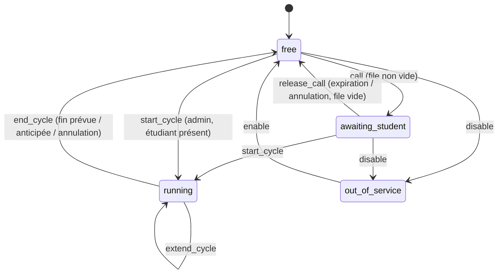
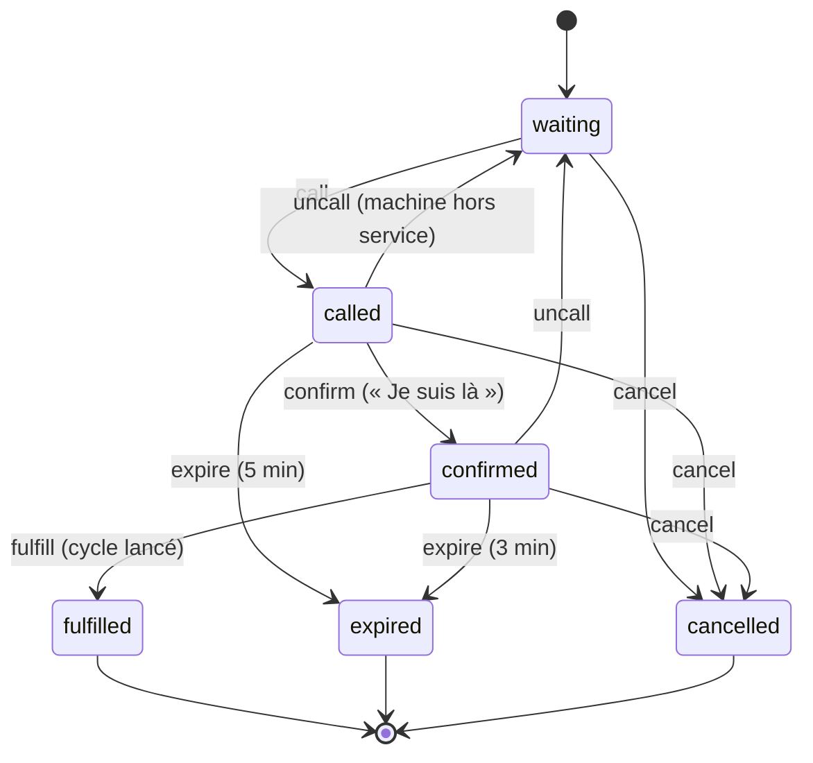

# Architecture

## Vue d'ensemble



Aucun processus ne tourne en permanence. Tout l'état — y compris les échéances (fin de cycle, délais
de présentation et de lancement, fermeture) — est en base, sous forme d'**heures absolues**. Chaque
requête commence par traiter les échéances dépassées ; cron-job.org n'est qu'un filet de sécurité pour
les moments où personne n'a la page ouverte. Un redémarrage, une mise en veille de la base ou un
nouveau déploiement ne perdent donc rien.

## Couches

```
src/server/domain/      Logique métier pure, sans entrée/sortie (testée unitairement)
  machine-state.ts        Machine à états d'une machine à laver
  reservation-state.ts    Machine à états d'une réservation
  queue.ts                Ordre de file, « première disponible », positions, rangs
  estimate.ts             Heures de disponibilité estimées
  opening-hours.ts        Horaires d'ouverture (Africa/Casablanca)
  laundry.ts              Moteur : commandes + traitement des échéances (settle)
src/server/services/    Transactions métier (laundry-tx), état (state-service), comptes, paramètres,
                        statistiques, historique
src/server/http/        Enveloppe commune des routes : CSRF, session, rôle, limitation, validation, erreurs
src/server/auth/        Mots de passe, sessions, protection des pages
src/server/db/          Schéma Drizzle, connexion (pg + attachDatabasePool sur Vercel), migrations
src/lib/                Partagé client/serveur : validation Zod, types de l'état, synchronisation, formats
src/components/         Interface React (laundry/ : commun et étudiant ; admin/ ; ui/)
src/app/                Pages et routes API (App Router)
```

Le moteur `Laundry` reçoit un instantané de l'état actif (machines, cycles en cours, réservations
actives, paramètres, horaires) et une heure `now`. Il applique les règles et renvoie la liste des
modifications, des entrées du journal et des messages à afficher aux étudiants. Le service le charge
dans une transaction, sous un verrou global, et enregistre le résultat. Toute la logique métier est
donc testable sans base de données (`tests/unit/laundry.test.ts`).

## Machine à états : machine



| Depuis             | Événement      | Vers               | Déclencheur                                                     |
| ------------------ | -------------- | ------------------ | --------------------------------------------------------------- |
| `free`             | `call`         | `awaiting_student` | Un étudiant de la file est appelé                               |
| `free`             | `start_cycle`  | `running`          | Admin : lancement direct pour un étudiant présent               |
| `free`             | `disable`      | `out_of_service`   | Admin                                                           |
| `awaiting_student` | `release_call` | `free`             | Expiration ou annulation de l'appelé (puis appel du suivant)    |
| `awaiting_student` | `start_cycle`  | `running`          | Étudiant (après « Je suis là ») ou admin                        |
| `awaiting_student` | `disable`      | `out_of_service`   | Admin (l'appelé retourne en file à sa place)                    |
| `running`          | `extend_cycle` | `running`          | Admin : prolongation                                            |
| `running`          | `end_cycle`    | `free`             | Fin prévue, fin anticipée ou annulation (puis appel du suivant) |
| `out_of_service`   | `enable`       | `free`             | Admin (puis appel du suivant)                                   |

Toute autre combinaison est refusée (`INVALID_TRANSITION`, HTTP 409). Une machine dont le cycle
tourne ne peut pas être mise hors service : il faut d'abord terminer ou annuler le cycle.

Couleurs et icônes : libre = vert, en attente de l'étudiant = orange, en cours = rouge, hors service = gris.

## Machine à états : réservation



| Depuis                           | Événement                               | Vers                      |
| -------------------------------- | --------------------------------------- | ------------------------- |
| `waiting`                        | `call`                                  | `called`                  |
| `called`                         | `confirm` (« Je suis là »)              | `confirmed`               |
| `confirmed`                      | `fulfill` (cycle lancé)                 | `fulfilled`               |
| `called`                         | `expire` (délai de présentation, 5 min) | `expired` (`no_show`)     |
| `confirmed`                      | `expire` (délai de lancement, 3 min)    | `expired` (`not_started`) |
| `called`, `confirmed`            | `uncall` (machine mise hors service)    | `waiting` (même rang)     |
| `waiting`, `called`, `confirmed` | `cancel`                                | `cancelled`               |

`fulfilled`, `expired` et `cancelled` sont terminaux. Le statut `fulfilled` (« honorée ») a été
ajouté aux cinq statuts du cahier des charges pour distinguer une réservation devenue cycle.

## File d'attente

- Chaque réservation a un **rang global** (ordre d'arrivée). Une réservation « première disponible »
  apparaît dans la file de toutes les machines.
- Quand une machine se libère, on appelle la réservation en attente de plus petit rang parmi celles
  qui ciblent cette machine ou acceptent « première disponible ».
- L'admin réordonne en plaçant une réservation avant une autre (rang intermédiaire ; la file est
  renumérotée si les rangs deviennent trop proches).

## Échéances (sans processus permanent)

Les échéances sont des heures absolues stockées en base : `cycles.planned_end_at`,
`reservations.call_deadline_at`, `reservations.confirm_deadline_at`, et la fermeture de la
buanderie (calculée depuis `opening_hours`). `Laundry.settle()` traite, dans l'ordre chronologique,
toutes celles qui sont atteintes :

- une fin de cycle ou une expiration est **datée de son échéance exacte** ;
- un étudiant appelé lors d'un rattrapage reçoit un délai qui **part du moment de l'appel effectif** :
  un appel n'a de sens que s'il peut être vu ;
- à la fermeture, les réservations en file sont annulées ; personne n'est appelé quand c'est fermé.
  Si l'admin modifie les horaires et que la buanderie devient fermée, la file est annulée aussitôt
  (une réservation ne peut pas être créée pendant la fermeture : une file qui existe à ce moment-là
  est forcément antérieure).

## Base de données

Schéma complet, diagramme et liste des contraintes : [`SCHEMA.md`](SCHEMA.md). En résumé, des index
uniques partiels garantissent au plus un cycle en cours par machine et par étudiant, au plus un
étudiant appelé par machine, et un rang unique dans la file ; des contraintes `CHECK` garantissent la
cohérence des statuts et des horodatages.

## Transaction métier

Chaque action (réserver, confirmer, lancer, piloter…) passe par `withLaundry` (`src/server/services/laundry-tx.ts`) :

```
BEGIN
  pg_advisory_xact_lock(clé globale)        ← les actions s'exécutent l'une après l'autre
  chargement de l'état actif (5 requêtes)
  settle()                                  ← échéances dépassées traitées d'abord
  action demandée (moteur Laundry)
  enregistrement : machines, réservations (rangs en deux phases), cycles,
                   journal d'activité, messages, laundry_state (version + 1, prochaine échéance)
COMMIT
```

Une règle non respectée lève une `DomainError` : tout est annulé et l'API répond avec le code
d'erreur (409, 403, 422…). Une violation de contrainte en base (qui ne devrait jamais arriver grâce
au verrou) est traduite en 409 `CONFLICT`.

## Sécurité

| Sujet                   | Mise en œuvre                                                                                                                                                                                         |
| ----------------------- | ----------------------------------------------------------------------------------------------------------------------------------------------------------------------------------------------------- |
| Mots de passe           | argon2id (19 Mio, 2 itérations) ; vérification factice si le compte n'existe pas (temps constant)                                                                                                     |
| Sessions                | jeton aléatoire de 256 bits dans un cookie `HttpOnly; Secure; SameSite=Lax` ; seule son empreinte SHA-256 est stockée ; 30 jours glissants ; suspension ou nouveau mot de passe = déconnexion partout |
| Mot de passe temporaire | toute route est refusée (`PASSWORD_CHANGE_REQUIRED`) tant qu'il n'est pas changé                                                                                                                      |
| Contrôle d'accès        | vérifié par l'enveloppe `route()` sur chaque route (`public`, `user`, `student`, `admin`), puis par le moteur pour les droits fins (sa propre réservation…)                                           |
| CSRF                    | toute requête autre que GET doit porter un en-tête `Origin` égal à `APP_URL`                                                                                                                          |
| Validation              | schémas Zod partagés (`src/lib/validation.ts`) pour les corps et paramètres                                                                                                                           |
| Limitation              | compteurs en base (fenêtre fixe) : connexion 10 / 15 min par compte et 100 / 15 min par IP (tout l'internat peut partager une IP), 60 actions / min par utilisateur ; jamais sur le rafraîchissement  |
| En-têtes                | `X-Frame-Options: DENY`, `nosniff`, HSTS, `Referrer-Policy`, `Permissions-Policy`                                                                                                                     |

## Horloge de test

La route `/api/test/clock` et le décalage d'horloge n'existent que si **toutes** ces conditions sont
réunies (`src/server/clock.ts`) ; sinon la route répond 404 et le décalage est ignoré :

1. `E2E_TEST_CLOCK=1` ;
2. aucune variable système Vercel (`VERCEL`, `VERCEL_ENV`, `VERCEL_URL`) ;
3. `DATABASE_URL` pointe vers localhost ;
4. `APP_URL` pointe vers localhost.

Sur Vercel avec Neon, les conditions 2, 3 et 4 sont impossibles : une erreur de configuration sur
`E2E_TEST_CLOCK` ne peut pas l'activer. Chaque cas est couvert par un test.

## Synchronisation des clients (sans serveur permanent)

Chaque page ouverte rafraîchit l'état par `GET /api/state` (`src/lib/sync/poller.ts`) :

| Situation                                             | Intervalle                                               |
| ----------------------------------------------------- | -------------------------------------------------------- |
| Étudiant appelé, présent, ou en tête de file          | 3 s                                                      |
| Étudiant dans les 3 premières places ; administrateur | 5 s                                                      |
| Tous les autres cas                                   | 15 s                                                     |
| Onglet caché                                          | **aucune requête** ; rafraîchissement immédiat au retour |
| Échéance personnelle proche (fin de cycle, délai)     | juste après l'échéance                                   |
| Après une action de l'utilisateur, retour du réseau   | immédiat                                                 |
| Erreur réseau                                         | 2, 4, 8… 30 s                                            |

Côté serveur :

```
GET /api/state   (If-None-Match: "v<version connue>")
 1 requête : laundry_state ⟕ sessions ⟕ users   → version, prochaine échéance, utilisateur actif
 ├─ pas de session valide                         → 401
 ├─ échéance atteinte → settleIfDue()             → verrou, re-vérification, traitement une seule fois
 ├─ version identique                             → 304 sans corps (1 seule requête SQL au total)
 └─ sinon                                         → état complet (transaction lecture seule REPEATABLE READ)
```

`settleIfDue()` re-vérifie `next_deadline_at` après avoir pris le verrou : si 50 téléphones
rafraîchissent au moment d'une échéance, un seul la traite ; les autres ne font qu'une lecture.

Confidentialité : un étudiant voit les positions et heures estimées de toutes les files, mais
seulement sa propre identité ; l'administrateur voit les noms, chambres et l'avertissement d'absences.

Les comptes à rebours sont calculés par le client à partir des heures de fin stockées en base
(`plannedEndAt`, `deadlineAt`) et du décalage d'horloge mesuré avec l'en-tête `X-Server-Now`.

## Interface

- **Rendu** : chaque page est rendue côté serveur avec l'état courant (affichage immédiat, ~0,9 s
  après la connexion mesuré sur téléphone simulé), puis le `StatePoller` prend le relais.
- **Alertes** (`alert-center.tsx`) : remplacent le Web Push. Sources : l'état (appel), les échéances
  connues à l'avance (1 minute avant l'expiration, fin de cycle — surveillées localement à partir des
  heures du serveur) et les messages enregistrés par le serveur (`notifications`), affichés au retour
  même si l'événement a eu lieu en l'absence de l'étudiant. Son Web Audio (débloqué au premier geste),
  vibration, titre clignotant, fenêtre plein écran (`alertdialog`) pour l'appel.
- **Accessibilité** : statut = couleur + icône + texte ; contrastes AA vérifiés ; focus visible ;
  navigation au clavier (y compris le glisser-déposer, via dnd-kit et des boutons ↑/↓) ; libellés et
  rôles ARIA ; `prefers-reduced-motion` respecté. Contrôlé automatiquement par axe-core sur 10 écrans.
- **Thème** : clair et sombre (`prefers-color-scheme`), jetons de couleur dans `globals.css`.

## Internationalisation

Textes dans `messages/fr.json` (next-intl), aucun texte en dur dans les composants. `lang` et `dir`
sont posés sur `<html>` selon la langue ; la mise en page utilise les propriétés CSS logiques
(`ms-`, `me-`, `ps-`, `text-start`…), donc l'arabe s'affichera de droite à gauche sans retouche. Les
heures passent par `Intl.DateTimeFormat` avec le fuseau `Africa/Casablanca` (base IANA : les
changements d'heure du Ramadan sont pris en compte) au format 24 h. Un test vérifie que chaque code
d'erreur, action du journal et type de message a son texte.

## Stratégie de tests

| Niveau       | Outil                         | Ce qui est couvert                                                                                                                                                                                 |
| ------------ | ----------------------------- | -------------------------------------------------------------------------------------------------------------------------------------------------------------------------------------------------- |
| Unitaires    | Vitest                        | Machines à états (toutes les combinaisons), moteur métier, file, estimations, horaires et fuseau, rythme et comportement du rafraîchissement (horloge simulée), formats, cohérence des traductions |
| Intégration  | Vitest + PostgreSQL réel      | Toutes les routes, matrice des droits, CSRF, limitation, concurrence, redémarrage, tâche planifiée, nombre de requêtes SQL du `304`, contraintes de la base                                        |
| Bout en bout | Playwright (téléphone simulé) | Parcours étudiant et administrateur, expiration au profit du suivant, synchronisation entre téléphones, hors ligne, onglet caché, accès, accessibilité (axe-core)                                  |

## Choix importants

| Choix                                                           | Raison                                                                                                     |
| --------------------------------------------------------------- | ---------------------------------------------------------------------------------------------------------- |
| Next.js sur Vercel, PostgreSQL Neon                             | Contrainte d'hébergement gratuit ; Neon s'intègre nativement à Vercel                                      |
| Échéances traitées à la lecture + cron de secours               | Pas de processus permanent sur Vercel ; la base est la seule source de vérité, un redémarrage ne perd rien |
| Verrou consultatif global par transaction                       | Quelques centaines d'actions par jour : la sérialisation ne coûte rien et supprime toute course            |
| Moteur métier pur (`Laundry`)                                   | Toutes les règles testables sans base ; services minces                                                    |
| Rafraîchissement avec version + `304`                           | Pas de service temps réel externe ; une seule requête SQL quand rien ne change                             |
| Rafraîchissement arrêté quand l'onglet est caché                | Quotas gratuits ; contrepartie : pas d'alerte écran verrouillé (voir README §10)                           |
| Statut `fulfilled` en plus des cinq du cahier des charges       | Distinguer une réservation devenue cycle d'une réservation active                                          |
| Appel lors d'un rattrapage : délai à partir de l'appel effectif | Ne jamais éliminer un étudiant « dans le passé » sans qu'il ait pu voir l'appel                            |
| File visible de tous, identités visibles seulement par l'admin  | Confidentialité des étudiants                                                                              |
| Tâche planifiée toutes les 15 min (et non chaque minute)        | Laisser Neon se mettre en veille : quota de calcul gratuit (README §7–8)                                   |
