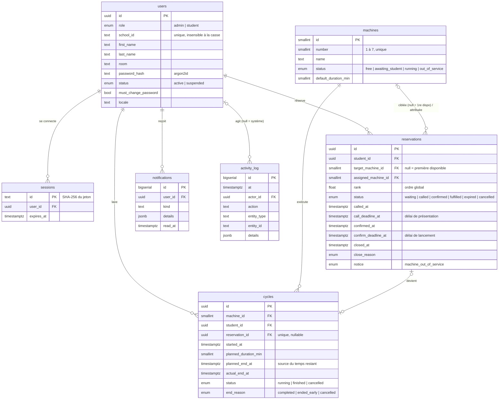

# Schéma de la base de données

Source de vérité : [`src/server/db/schema.ts`](../src/server/db/schema.ts) (Drizzle ORM).
Migrations SQL versionnées : [`drizzle/`](../drizzle) — `0000_init.sql` (tables, index, contraintes)
et `0001_reference_data.sql` (7 machines, paramètres par défaut, horaires, état de synchronisation).
Les migrations sont appliquées par `pnpm db:migrate`, automatiquement à chaque déploiement Vercel.

Toutes les dates sont des `timestamptz` (instants UTC) ; l'affichage se fait en `Africa/Casablanca`.

## Diagramme

Tables à ligne unique (sans relation) : `settings`, `laundry_state` ; une ligne par jour :
`opening_hours` ; technique : `rate_limits`.

## Tables

| Table           | Rôle                                                                                                                                                |
| --------------- | --------------------------------------------------------------------------------------------------------------------------------------------------- |
| `users`         | Comptes étudiants et administrateurs. Le mot de passe n'est jamais stocké, seulement son empreinte argon2id.                                        |
| `sessions`      | Sessions de connexion (30 jours glissants). L'identifiant est l'empreinte SHA-256 du jeton du cookie.                                               |
| `machines`      | Les 7 machines et leur état (machine à états, voir `ARCHITECTURE.md`).                                                                              |
| `cycles`        | Cycles de lavage. `planned_end_at` est la référence de tout compte à rebours.                                                                       |
| `reservations`  | Réservations et files d'attente (`rank` = ordre d'arrivée global, réordonnable).                                                                    |
| `settings`      | Paramètres (délais 5 et 3 min, durées proposées, réservations max, lancement par l'étudiant, seuil d'absences). Une seule ligne (`id = 1`).         |
| `opening_hours` | Horaires d'ouverture par jour (1 = lundi … 7 = dimanche), en minutes depuis minuit, heure de Casablanca ; `close_minute = 1440` = minuit.           |
| `laundry_state` | Une ligne : `version` (incrémentée à chaque modification, sert au `304`) et `next_deadline_at` (prochaine échéance, évite tout traitement inutile). |
| `notifications` | Messages affichés dans la page de l'étudiant (appel, expiration, fin de cycle…), même s'il était absent au moment de l'événement.                   |
| `activity_log`  | Journal d'activité : qui (ou le système), quoi, quand, sur quoi.                                                                                    |
| `rate_limits`   | Compteurs de limitation des requêtes (connexion, actions). Purgés toutes les heures.                                                                |

## Garanties apportées par la base

En plus du verrou global pris par chaque transaction métier (`pg_advisory_xact_lock`) :

| Garantie                                                    | Contrainte                                                                                               |
| ----------------------------------------------------------- | -------------------------------------------------------------------------------------------------------- |
| Un seul cycle en cours par machine                          | index unique partiel `cycles_one_running_per_machine_uq` (`where status = 'running'`)                    |
| Un seul cycle en cours par étudiant                         | index unique partiel `cycles_one_running_per_student_uq`                                                 |
| Un seul étudiant appelé ou présent par machine              | index unique partiel `reservations_one_called_per_machine_uq` (`where status in ('called','confirmed')`) |
| Ordre de file sans ambiguïté                                | index unique partiel `reservations_waiting_rank_uq` (`where status = 'waiting'`)                         |
| Réservation appelée = machine + échéance                    | `CHECK reservations_called_has_machine_ck`                                                               |
| Statut actif ⇔ pas de date de clôture                       | `CHECK reservations_closed_consistency_ck`, `cycles_closed_consistency_ck`                               |
| Numéros 1 à 7, durées et délais bornés, horaires cohérents  | `CHECK machines_number_ck`, `cycles_duration_ck`, `settings_*_ck`, `opening_hours_range_ck`              |
| Identifiant de l'école unique sans tenir compte de la casse | index unique sur `lower(school_id)`                                                                      |
| Une seule ligne de paramètres / d'état                      | `CHECK id = 1`                                                                                           |

Ces garanties sont vérifiées par `tests/integration/schema.test.ts`.

## Index utiles aux performances

- `cycles_running_end_idx`, `reservations_active_idx` : chargement de l'état actif (quelques lignes) ;
- `notifications_unread_idx` : messages non lus d'un étudiant ;
- `activity_log_at_idx`, `activity_log_entity_idx`, `activity_log_actor_idx` : journal et litiges ;
- `reservations_closed_idx`, `cycles_started_idx` : statistiques et absences récentes.

## Faire évoluer le schéma

1. Modifier `src/server/db/schema.ts`.
2. `pnpm db:generate --name <description>` crée une nouvelle migration dans `drizzle/`.
3. Relire le SQL généré, puis `pnpm db:migrate` en local et `pnpm check`.
4. Envoyer : la migration est appliquée au prochain déploiement.
